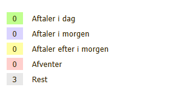

# Bruger administration

## Formål

At kunne administrere brugerne til en klient.

**Det er kun support der  kan oprette brugere.**

Administration af brugere omfatter
- Tildeling af password
- Angiver
  - initialer
  - Fornavn
  - Efternavn
  - Email
  - Mobil
- Aktivere eller Inaktivere brugere
- angive rettigheder for brugere (Indstilling)
- Låsning af bruger til enhed

## Forudsætninger

For at kunne til gå administration og herunder Bruger administration skal du have en af rollerne

- Firma Admin/Mester
- Kontor

## Forklaring

![Bruger oversigt][Bruger oversigt]

1. Login
  Det brugernavn der skal bruges for at logge ind
  Under Brugernavnet, står angivet hvilken rolle brugeren har
  Oprettelse af brugernavn eller ændring af rolle - Kontakt Support

2. Kodeord (Adgangskode)
  Den kode der skal angives når der skal logges på systemet.
  Det er ikke muligt at se hvad kodeordet er.
  Glemmes koden, er det muligher at tildele en ny adgangskode [Tildel eller skift adgangskode](Tildel_eller_skift_adgangskode.md)

3. Initialer

4. Fornavn

5. Efternavn

6. Email
    **Ved ændring af E-mail eller adgangskode til E-mail**
    Kontakte Support for opsætning af afsendelse af E-mail via systemet

7. Aktivere Autorisation af E-mail
    Der markeres om E-mail er en  [GMail][OAUTH GMail] eller om det er en [Outlook-mail][OAUTH Outlook] ( f.eks. brugerskorstensfejeren.dk)

8. Angivelse af mobilnummer

9.  Er låst til enhed
    Mulighed for at låse bruger til kun at kunne bruge en bestemt enhed og bestemt program (browser)
    Ved tryk på
    ![Klik for at låse][Klik for at låse]
    Så vil brugeren blive låst til den enhed og program, hvor det gøres fra.
    Når en bruger er låst til en enhed vil det stå
    ![Låst til enhed][Låst til enhed] når der er logget på "Bruger Administration" fra samme enhed.
    Hvis du er logget ind på "Bruger Administration" fra en anden enhed, så vil det således ud
    ![Låst til anden enhed][Låst til anden enhed]

    Det er muligt at fjerne indstilling ved at trykke på det røde kryds til højre

10. Status
    Er bruger aktiv.
    Giver mulighed for at inaktivere brugeren.
    Ved tryk på "--- Vis inaktiv ---" i bunden vil det være muligt at se de brugere der er blevet inaktiveret.
    Her vil det også være muligt at aktivere brugerne igen, hvis der er behov for det.

11. **\+** (visning af indstillingerne for brugeren.)
    **\-** ( Skjul indstillinger for brugeren)

    Det er muligt at angive forskellige indstillinger for en enkelt bruger.
    Se [Indstillinger](#indstillinger)

### Indstillinger

![Oversigt over indstillinger][Oversigt over brugerindstillinger]

- **Kunder på mobilen**
  Det er muligt at få kontakter fra FejerPro ned på telefonen

  - Tlf type:
    - Android
      Se her hvordan det gøres
      [Kontakter på telefonen Android][Kontakter på telefonen android]
    - iPhone
      [Kontakter på telefonen iPhone][Kontakter på telefonen iPhone]
  - Tlf Adg.: kode
      Der bruges en anden adgangskode for brugeren til at hente kontakter end til at logge på.

Arbejdssedlen
- **Tilsig andre**
    Giver brugeren mulighed for at kunne lave tilsigning på vegne af andre brugere.
    Det kan ske enten, når tilsigningen laves, eller senere at ændre hvem der skal udfører arbejde (Hvem har det i sin kalender).
    Dette giver også mulighed for at kunne lave aftaler i kalenderen pva. andre brugere.

- **Vis tilsagte i liste**
  På siden med oversigten over arbejdssedler kommer der ude til venstre en oversigt over hvor mange aftaler der er i dag, i morgen, efter i morgen, afventer og rest.

  Listen til venstre fortæller kun om brugerens egne aftaler

    

- **Vis tilsagte på arbejdsseddel**

- **Tillad "Redigér sager" på arbejdsseddel**

  Denne instilling gør det muligt for brugeren at kunne redigere i sagerne på arbejdssedlen

  Der vil blive vist en knap, med mulighed for at kunne redigere i arbejdssedlen

  ![Knap til redigering i sager][Knap til redigering i sager på arbejdsseddel]

- **Brug arbejdseddel Version**
  Hvilken version af arbejdssedlen skal bruges
  - Version 2
      Det klassiske udseende på arbejdssedlen

      ![Version 2 udseende][Version 2 udseende]

  - Version 3
    Version er lavet på baggrund af, at der var ønsket et mere modernet og tidsvarende udseende.
    Det er begrænset hvor meget det bruges.

      ![Version 3 udseende][Version3 Udseende]

  - V2/V3
      Giver brugeren mulighed for selv at vælge hvilken version af arbejdssedlen denne ønsker at bruge.

- **Kan ikke færdigmelde for andre**
      Denne indstilling er kun aktuelt for brugere med rollen FirmaAdmin, Mester eller kontor.
      Normalt vil det være muligt for disse roller at kunne færdigmelde for andre.
      Når denne markering er sat, så kan de kun færdigmelde for sig selv.

- **Færdigmeld 1 ad gangen**
    Begrænser brugeren til at kun at kunne færdigmelde en ad gangen.
    Det forhindre brugeren i at kunne færdigmelde en stribe af ejendomme på en gang.

- **Automatik Send rapport**
    Der sættes automatisk markering i "send rapport" når der færdigmeldes en sag på en ejendom.
    Fejeren kan fjerne markeringen på version 2 arbejdssedler.
    Markeringen er ikke synlig på version 3, hvorfor den ikke kan sættes eller fjerne.
    Det er muligt manuelt at trykke på "Besøgsrapport" og sende den vej fra.

- **Send altid rapport**
  Sikre at der altid bliver sendt en besøgsrapport, når der er udført arbejde på ejendomme.
  Den sætter markering i "send rapport" og det er  ikke mulighed for fejeren at fravælge dette.

- **Tillad ikke sletning af besøg**
    Når denne indstilling er sat, får brugeren ikke muligheden at slette et besøg på arbejdssedlen.
    Det røde kryds ved besøg vil stadig være der, men det vil kun være muligt at annullere besøget.

- **Tillad ikke Annulléring af besøg**
    Når denne indstilling er sat, får brugeren ikke muligheden for at annullere eller slette et besøg på arbejdssedlen.
    Det røde kryds forsvinder ved besøg forsvinder.

- **Skjul kalenderen for svend brugerne**
    Er denne indstilling sat, så vil det ikke være muligt for de andre svende at se hans kalender.
    Brugere med rollen "Firma admin", "kontor" eller "mester" vil stadig kunne se kalenderen.

- **Begrænset visning af arbejdssedler**
  Normalt har brugeren mulighed for at se alle arbejdssedler
  Når denne indstilling gør at brugeren kun kan se sine egne og de arbejdssedler der ikke er tildelt nogen

- **Vis altid rester på kalenderen**
      Er denne markering sat, så vises rester på kalenderen, og markering på kalenderen "vis rester" kan ikke aktiveres eller deaktiveres
      Hvis den ikke var sat før denne indstilling blev aktiveret, så markering på kalenderen "Vis rester" ikke være markeret, selvom den er aktiveret

- **Tilsigningsdato sættes manuelt**
    Med denne indstilling kommer der en popup kalender frem ved tilsigning
    Er denne indstilling ikke sat, vil den automatisk indsætte næste mulige arbejdsdag, hvor tilsigningen kan laves.
    Popup kalenderen viser som standard automatisk næste mulige arbejdsdag, hvor tilsigningen kan laves.

- **Tillad ikke rekvirering af ture**
    Brugeren kan normalt - via siden for Arbejdssedler - selv rekvirerer ture.
    Ved at sætte denne markering, fjernes denne mulighed for brugeren

- **Skjul enheder**
    På arbejdssedler og sager bliver det vist hvor mange enheder en arbejdsseddel eller sag er tildelt.
    Ved at sætte denne indstilling kan brugeren ikke se disse enheder

- **Tillad ikke tildeling af ture**
    Normal vil de være mulighed for at rollerne "Svend 1" og "Svend 2" kan tildele arbejdssedler til sig selv.
    Sættes denne indstilling, vil de ikke have denne mulighed

    Rollerne "FirmaAdmin", "Mester" og "Kontor" kan normalt tildele ture til de forskellige brugere.
    Med denne indstillinger så mister denne mulighed

-	**Tillad "Opret ny ejendom" (Svend 2)**
   Med denne indstilling sat, vil det være muligt for rollen "Svend 2" at oprette en ny ejendom via menupunktet "Kontakter"

- **Ignorer spørgeskemaet på arbejdseddel**
    Gør det muligt at ignorer spørgsmålen fra spørgeskema
    Er denne indstilling ikke sat, vil den kræve at mindst et spørgsmål fra spørgeskema skal besvares, for at Færdigmelde et besøg.
    Hvis ikke alle spørgsmål er besvaret, vil den også kræve at der besvares mindst et spørgsmål mer ved tryk på besøgrapport.

Stamkort
- **Brug ikke regulering**
    Hvis brugeren ændre på sager på en ejendom der er kommunalt opkrævet, så vil der normal skulle ske en regulering af den kommunale opkrævning.
    Det vil betyde at der kommer et popup besked op, og spørge om der skal oprettes en regulering.
    Er denne indstilling markeret, så vil der ikke ske en regulering på den kommunalle opkrævning, og popup beskeden vil ikke komme.

- **Åbne faner på stamkort**
    Her er det muligt at vælge hvilke afsnit af et stamkort der skal åbnes automatisk når brugeren går ind på det.
    Der kan vælges et eller flere af disse afsnit
  - regninger
  - kommentarer
  - dokumenter
  - kommunal
  - historik
  - gamle poster

- **Vis besøg Ved**
  Når brugeren kommer ind på stamkort kan de vælges om afsnittet med "Besøg" skal åbnes
  Der er mulighed for følgende indstillinger
  - åbne besøg
    "Besøg" åbner kun, hvis der er åbne besøg på ejendommen
  - Altid
    "Besøg" åbner altid
  - Aldrig
      Åbner aldrig for afsnittet "Besøg"

  Selvom afsnittet med "Besøg" ikke åbnes automatisk, så vil det altid være muligt at åbne/lukke det ved at trykke på "Besøg"

Andet
- **Brug tidsregistering**
    Mulighed for at brugeren kan registrere sin arbejdstid

- **Startside**
  Hvilken side skal der åbnes, når brugeren ligger ind
  Hvilke sider der kan vælges imellem afhænger af brugerens rolle
  For rolle
  - Svend 2
    - Arbejdssedler
    - Kontakter
  - Svend 1
      Samme roller som Svend 2 plus
    - Stamkort
    - Regninger
  - FirmaAdmin, Mester, Kontor og Kommune
      De samme roller som for Svend 1

- **Regninger til godkendelse**
    Skal regninger godkendes ( Sendes til Kontor)
  - ---
    Regningen afsluttes med det samme
  - Godkendelse af manuelle
    Faktura oprettet af Brugeren skal godkendes af en bruger med rollen "Kontor", "Mester" eller "FirmaAdmin"
  - Godkendelse af alle fakturaer
    Alle Faktura der dannes, og de automatiske der dannes ved færdigmelding af besøg skal godkendes på samme måde som faktura oprettet af bruger

- **E-mail afsender**
  - Tekst felt
    I dette felt kan der angives en tekst for afsenderen af en mail som denne bruger sender via FejerPro
    Standard er "Skorstensfejer <fornavn> <Efternavn>"

- **E-mail signatur**
    Personlige signatur der bruges når brugeren sender E-mail via FejerPro
    Den tilføjes til sidst i E-mailen

  - **Kopi firma signatur**
    Det er muligt at kopiere Firmaet signatur og dermed mulighed for at få en ensartet signatur for alle medarbejder i Firmaet.

  - Tilføj logo
    Gør det muligt at tilføje forudbestemte logos til signaturen.
    Der kan bruges af de generele logos, eller eget Logo, hvis det er blevet lagt ind i systemet via Support.
    ![Logos der kan vælges fra systemet][LogoListe]

## Forskelle på version 2 og version 3 arbejdssedler

- Udseende er anderledes
  udseendet er mere  synligt delt op i felter.
  I stedet for link, er det sigende ikoner (små billeder) for "Anmærkning","Ny kommentar", "Tilsigning". "Forgæves", "Annuller", "Besøgsrapport". "Udført","Redigere sager" og "Dan faktura"
- Følgende markeringsmuligheder er ikke på arbejdssedlen
  - Markering i "send rapport"
      Hvis ikke indstillingen "Automatisk Send rapport" eller "Send altid rapport" er sat, bliver der ikke sendt en besøgsrapport.
      Besøgsrapport sendes da ved at trykke på "Besøgsrapport"
  - Markering i "rest"
      Rest Markeres i Besøgsrapporten

[Reference billeder]: <# Billede referencer>
[Bruger oversigt]: <../../../images/Brugeradministration/image.png>
[LogoListe]: <images/Brugeradministration/image-1.png>
[Version 2 udseende]: images/Brugeradministration/image-2.png
[Version3 Udseende]: <images/Brugeradministration/image-4.png>
[Knap til redigering i sager på arbejdsseddel]: images/Brugeradministration/image-5.png
[Klik for at låse]: images/Brugeradministration/image-7.png
[Låst til enhed]: images/Brugeradministration/image-6.png
[Låst til anden enhed]: images/Brugeradministration/image-8.png

[Reference]: <# Link referencer>
[OAUTH GMail]: <../../../Svend2/oauth til afsendelse af mail/Forbind til gmail/tilføj oauth til gmail.md>
[OAUTH Outlook]: <../../../Svend2/oauth til afsendelse af mail/forbind til outlook mail>
[Oversigt over brugerindstillinger]: images/Brugeradministration/image.png
[Kontakter på telefonen android]: <../../../Svend2/hent kontakter til telefonen/Android/kontakter til android telefon.md>
[Kontakter på telefonen iPhone]: <../../../Svend2/hent kontakter til telefonen/iPhone/kontakter til iPhone.md>
