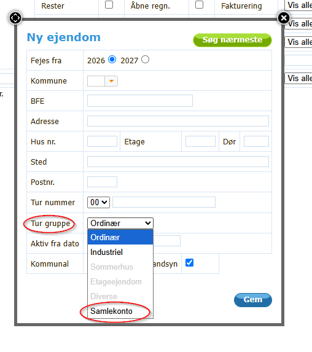
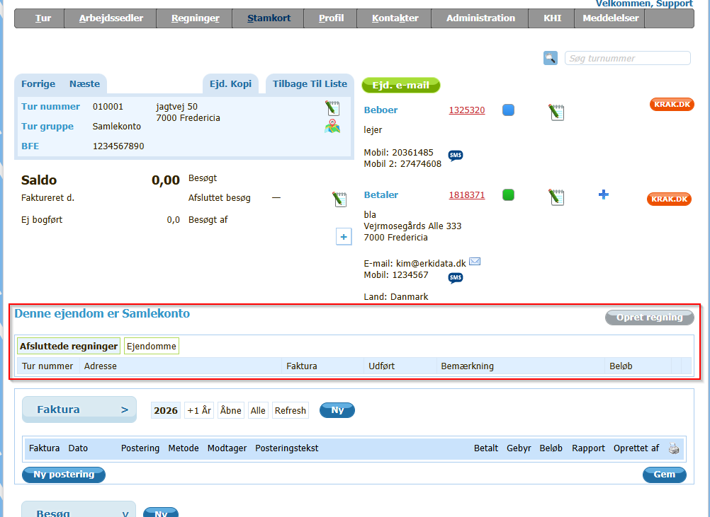
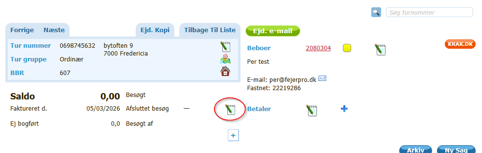
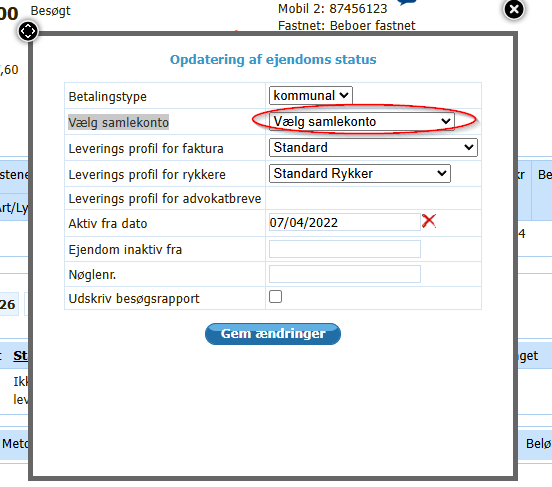
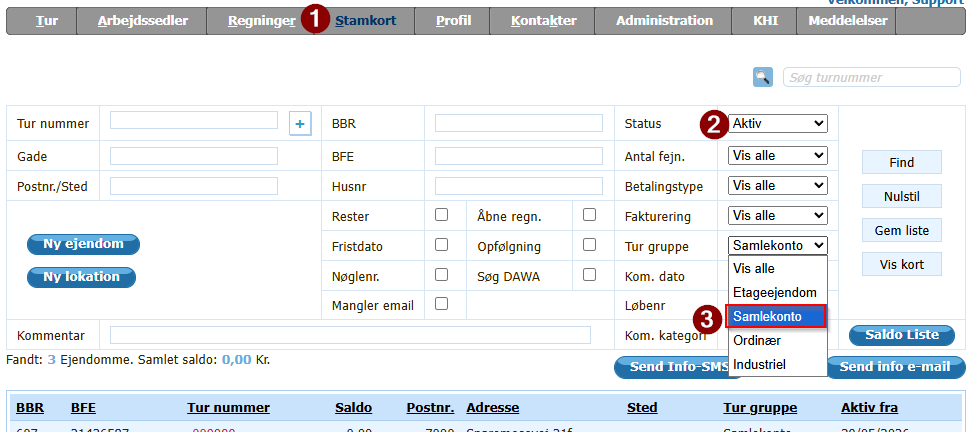
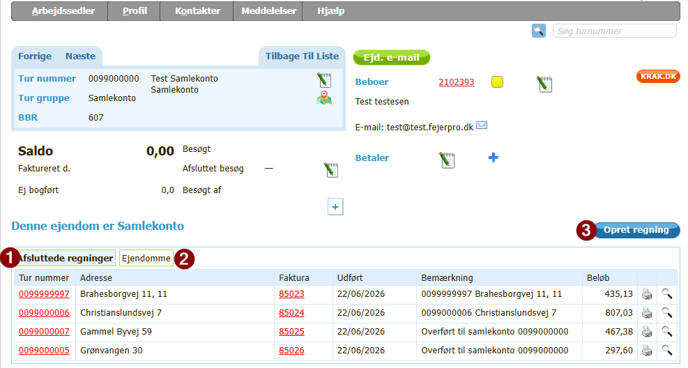
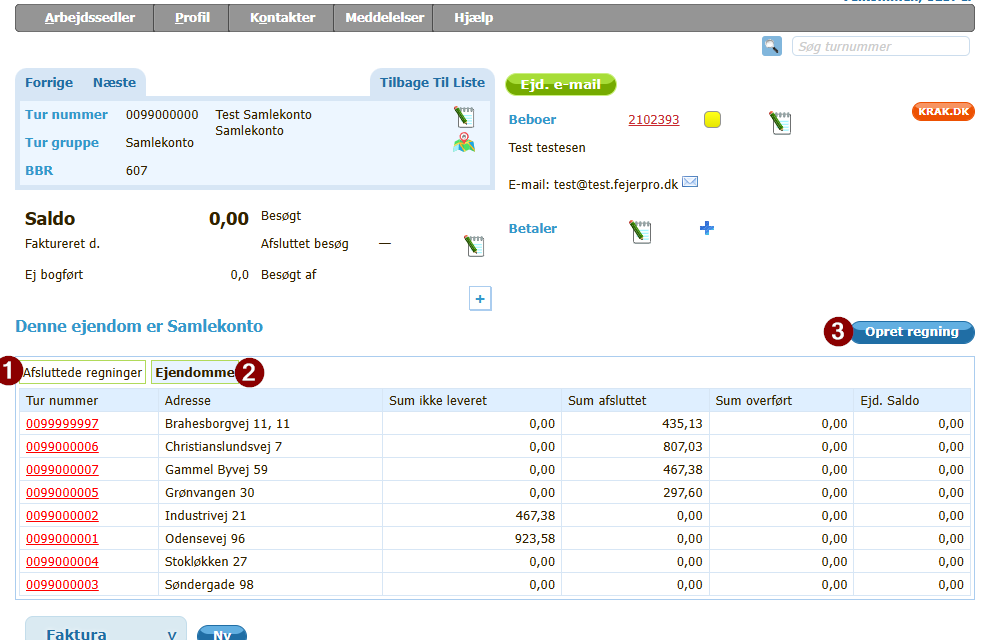
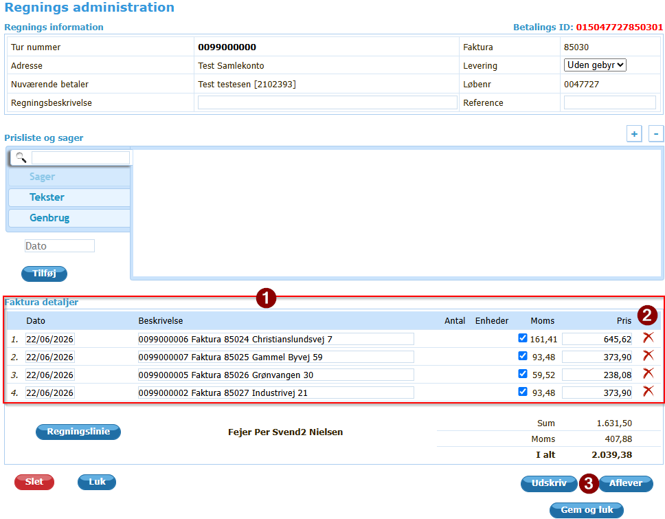

# Samlekonto

Har du flere ejendomme, som skal opkræves samlet, så kan du oprette en ejendom med turgruppe Samlekonto.

- En ejendom oprettet som SamleKonto kan ikke fejes.  

- Det er ikke muligt at oprette sager på denne ejendom.

For de ejendomme, som så skal faktureres via denne konto, skal samlekontoen vælges under "Opdatering af ejendoms status" i feltet "Vælg samlekonto"
Se [Tilmeld ejendom til samlekonto](#tilmeld-ejendom-til-samlekonto)

- [Samlekonto](#samlekonto)
  - [Forudsætninger](#forudsætninger)
    - [Roller der kan bruge Samlekonto](#roller-der-kan-bruge-samlekonto)
    - [Indstillingen "Bruger Samlekonto" er aktiveret](#indstillingen-bruger-samlekonto-er-aktiveret)
    - [Ingen sager på ejendommen](#ingen-sager-på-ejendommen)
  - [Vejledning til Samlekonto.](#vejledning-til-samlekonto)
    - [Oprettelse af ejendom som samlekonto](#oprettelse-af-ejendom-som-samlekonto)
    - [Tilmeld ejendom til samlekonto](#tilmeld-ejendom-til-samlekonto)
  - [Hvordan ses det hvilke ejendomme der er Samlekonto](#hvordan-ses-det-hvilke-ejendomme-der-er-samlekonto)
  - [Hvordan oprettes regning for Samlekonto](#hvordan-oprettes-regning-for-samlekonto)
    - [Vejledning til at se hvilke fakturaer der er afsluttet til ejendom med Samlekonto](#vejledning-til-at-se-hvilke-fakturaer-der-er-afsluttet-til-ejendom-med-samlekonto)
    - [Opret regning for Samlekonto](#opret-regning-for-samlekonto)
      - [**Advarsel**](#advarsel)

## Forudsætninger

### Roller der kan bruge Samlekonto

- Firma Admin
- Mester 
- Kontor
- Svend1

Alle brugere der kan oprette nye ejendomme

### Indstillingen "Bruger Samlekonto" er aktiveret

Det er kun FejerData support, der kan ændre denne indstilling.
Hvis indstillingen ikke er aktiveret, kan du ikke oprette en ejendom med turgruppe "Samlekonto". Ring da til support på 9292 1256 eller skriv til e-mail: info@fejerpro.dk

### Ingen sager på ejendommen

En eksisterende ejendom kan ændres til Samlekonto, ved at slette alle sager på ejendommen.

Derefter er det muligt i boksen "Ejendomsinformation" under "Tur gruppe" at vælge Samlekonto.

## Vejledning til Samlekonto.

### Oprettelse af ejendom som samlekonto

- Gå i menuen "Stamkort"
- Vælg "Ny ejendom"
- Udfyld oplysninger i boksen "Ny ejendom" som normalt
- Vælg i "tur gruppe" Samlekonto 

    
- Tryk på "Gem"

En ejendom som er Samlekonto ser således ud 

Som det ses tydeligt i det her rødt indrammede felt, så står der med store bogstaver "Denne ejendom er Samlekonto"

Herunder ses så mulighed for at se, hvilke afsluttede regninger der er overført til Samlekontoen "Afsluttede regninger"
Det er også muligt at se, hvilke ejendomme der er tilknyttet denne Samlekonto, ved at vælge "Ejendomme"

Det vender jeg tilbage til senere, når vi opretter regninger til Samlekontoen

### Tilmeld ejendom til samlekonto

En ejendom tilmeldes en Samlekonto ved at 

- Gå i menuen "Stamkort"  
- indtast og vælg de filter oplysninger for at finde ejendommen  
  - Du kan også indtaste turnummer oppe i højre hjørne   
- Vælg ejendommen   
    ( Hvis du har søgt på turnummer eller indtastet turnummer oppe til højre, kommer du direkte ind på ejendommen)  
- vælg notesblokken under det blå felt med ejendomsinformationer (Se markering på billedet herunder)  

      

- I boksen der kommer op, i feltet "Vælg samlekonto" vælges den ejendom der skal bruges som samlekonto  

    

## Hvordan ses det hvilke ejendomme der er Samlekonto

Ind imellem kan det være godt lige at kunne se, hvilke ejendomme der er registreret som Samlekonto.

Samlekonto er en turgruppe.

På siden Stamkort (1) kan der i filteret "Tur gruppe" (3) vælges Samlekonto.

Normalt står filteret "Status" (2) på "Aktiv"

Hvis det ønskes, kan der også her vælges en anden status, f.eks. "Vis alle", hvis du vil se både aktive og ikke aktive ejendomme med Samlekonto

## Hvordan oprettes regning for Samlekonto

Når en faktura oprettes på en ejendom, der er tilmeldt en Ejendom med Samlekonto, så overføres fakturaen til Samlekontoen, når fakturaen afsluttes.

Fakturaen afleveres på samme måde som på alle andre ejendomme, hvor der laves faktura.

Når fakturaen er afsluttet, vil det kunne ses på ejendommen med Samlekontoen

### Vejledning til at se hvilke fakturaer der er afsluttet til ejendom med Samlekonto

Vælg ejendom med Samlekonto - se [Hvordan ses det hvilke ejendomme der er Samlekonto](#hvordan-ses-det-hvilke-ejendomme-der-er-samlekonto)

Når regningerne på de tilmeldte ejendomme er afsluttet, vil de kunne ses under "Afsluttede regninger"(1)

  

### Opret regning for Samlekonto

Ved at trykke på "Opret regning"(3) oprettes en regning på Samlekontoen, der indeholder de afsluttede fakturaer.

#### **Advarsel**
**Bemærk: Ved tryk på "Opret regning" (3) bliver de listede fakturaer i "Afsluttede regninger" overført til regningen og får samtidig status "Overført"**  
**Ved sletning af fakturaen, eller sletning af de enkelte fakturalinier ændres denne status ikke**  
**Skal en faktura for en ejendom ikke med på regningen, er det nødvendigt først at genåbne regningen for den ejendom - der ikke ønskes skal med på regningen, for at den ikke kommer med**   

  kontakt ***Support***, hvis det skulle det ske, at en faktura ved en fejl er kommet med på regningen, og derfor er blevet slettet efter oprettelse af regning.

Ved tryk på "Opret regning" (3) får du fakturaen frem der bliver dannet

Den ser ud som alle andre fakturaer

Under fakturadetaljer (1) ses en regningslinie for hver afsluttet faktura for ejendomme tilmeldt Samlekontoen.
Regningsliniens beskrivelse indeholder oplysninger om turnummer, fakturanummer og adresse samt totalbeløbet på fakturaen  

Ud til højre (2) ses det røde slette kryds.

**se [Advarsel](#advarsel) - Det er muligt at slette en regningslinie med slettekrydset**

Inden fakturaen afsluttes, kan der som på alle andre fakturaer tilføjes flere regningslinier.

Når regningen er klar til levering, trykkes der på "Aflever" / "Til kontor" (3) ligesom på andre fakturaer

