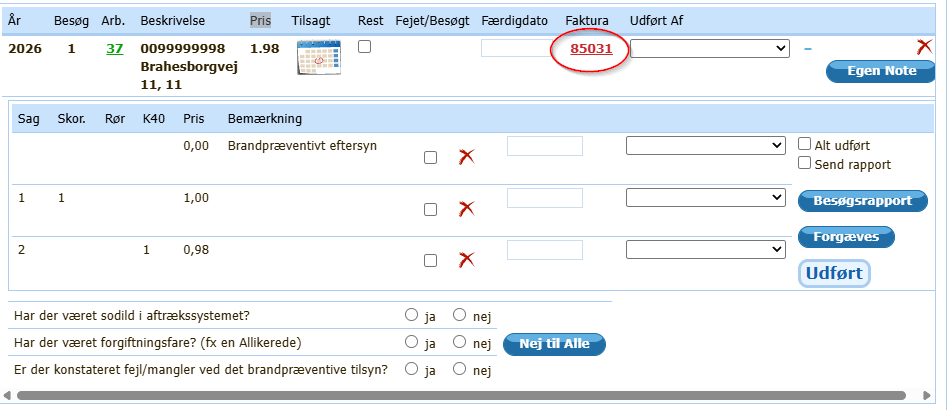
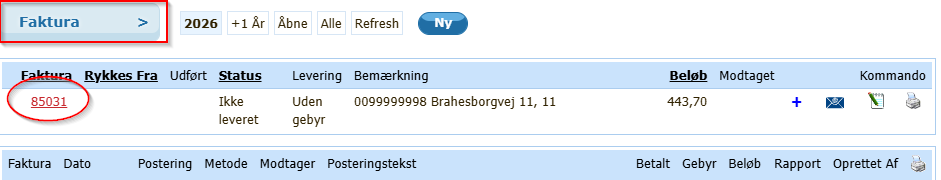
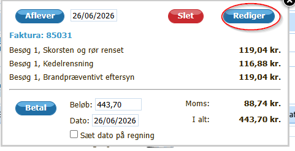
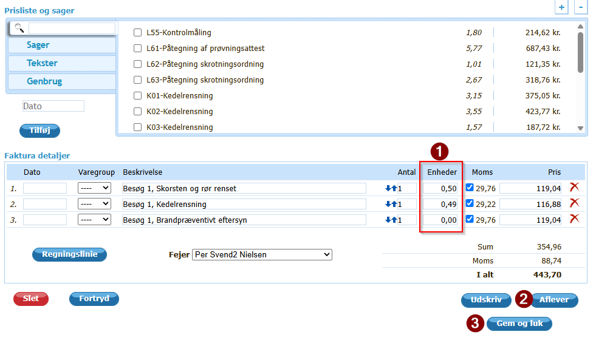
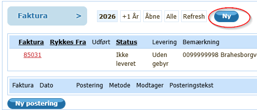
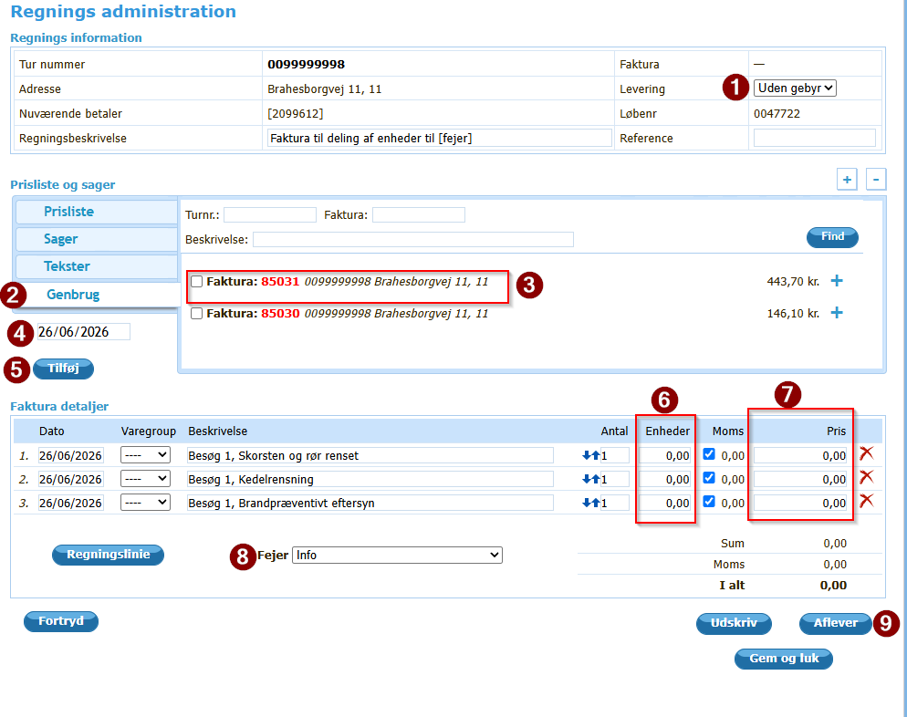
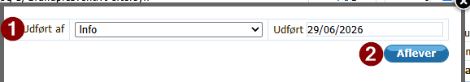
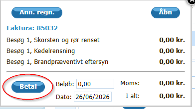
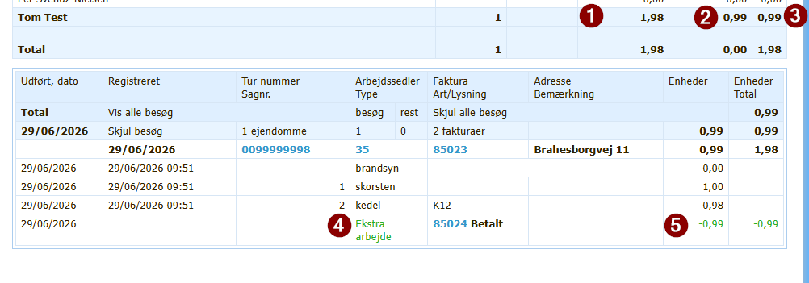

# Hvordan enheder for en opgave kan deles mellem flere fejere

## Beskrivelse

Ved nogle opgaver/fejninger er der flere fejere om at løse opgaven/fejningen.
Ved oprettelse af fejningen vil kun den ene fejer få tildelt enheder for løsning af opgaven, da der på fakturaen kun kan være én fejer tilknyttet.

Det er kun muligt at ændre enheder for ekstra besøg på ejendommen.

## Forudsætninger

At du har tilladelse til at oprette og rette i faktura.

At det er et ekstra besøg.

## Kort vejledning

For at dele enhederne ud mellem fejerne kan der gøres følgende:

1. På den primære faktura rettes enhederne for udførelse af opgaven.
2. For hver af de øvrige fejere oprettes en 0-faktura (beløbene er på 0,00 kr.)
   1. Enhederne tilpasses på denne faktura, så de svarer til, hvad denne fejer skal have.
   2. **Når fakturaen er oprettet, er det vigtigt, at den med det samme bliver registreret som betalt, så der ikke sendes flere fakturaer på samme opgave.**
3. Trin 2 gentages for hver fejer.

## Detaljeret vejledning

1. Gå ind på fakturaen for opgaven
    

    Eller

    

2. Vælg at redigere faktura

   

   1. Ret enheder (1)

       

   2. Når enhederne er rettet, gemmes (3) eller afleveres (2) fakturaen.

       Enhederne tildeles, når fakturaen afleveres/"Til kontor".

3. Opret 0-faktura
   1. Ved faktura på ejendommen vælges "Ny"

        

   2. Ret levering (1) til "Uden gebyr"
        Ved at vælge denne type kommer der ikke administrationsgebyr på regningen, som det ellers kunne ske.

   3. Vælg genbrug (2) og vælg faktura (3)

    

   4. Indsæt dato (4)
   5. Tryk på "Tilføj" (5)
        Posteringslinjerne fra den valgte faktura kommer nu på fakturaen.

   6. Ret beløb til 0,00 kr. (7)
   7. Ret enheder (6) (**hold øje med, om enheder ændrer sig ved rettelse af beløb**)
   8. Vælg fejeren, der skal have enhederne (8)
   9. Tryk på "Aflever"/"til kontor" (9)
4. I boksen, der kommer op

    

   1. Se, at "Udført af" (1) er den rigtige
        Hvis det ikke er rigtigt, kan det rettes her.
   2. Se, at datoen er rigtig
        Hvis den ikke er rigtig, er det muligt at rette den her.
   3. Tryk på "Aflever"/"til kontor" (2)
5. Nu er regningen i status "Leveret".
6. **Vigtigt!** Tryk på den dannede faktura og vælg "Betal".

    

7. Punkt 3 til 6 gentages for hver ekstra fejer, der skal have enheder for opgaven.

## Tips

Skulle der være flere fejere ude til et ordinært besøg, og enhederne skal deles imellem fejerne, så er det muligt at oprette en 0-faktura med negative enheder.

Som det ses af nedenstående billede, kan siden med "Statistik på udført arbejde" snyde lidt.

1. Viser det antal enheder, der gives for ordinært besøg
2. Viser antal enheder for ekstra arbejde (selvom det står her som et positivt tal, så er det negativt)
3. Det totale antal enheder (og her kan det ses, at de 0,99 er blevet trukket fra de 1,98, som det ordinære besøg her giver)
4. 0-fakturaen er registreret som "ekstra arbejde"
5. Viser antal enheder, som ekstra arbejdet giver (her -0,99)

