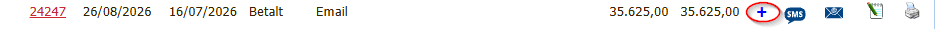
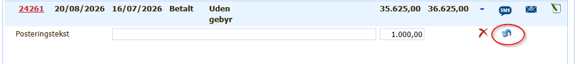

# Tilbeførelse af formeget betalt regning

## Beskrivelse

Det sker ind imellem at en kunde får betalt for meget på en regning og beløbet skal tilbageføres til kunden.

Det kan også være at kunden har betalt en regning kunden ikke skulle have betalt.

## Forudsætning

Du har en af følgende roller
- Kontor
- Mester
- Firma Admin

Support kan også gære det.

## Vejledning

1. Lav en kreditnota på beløbet der skal tilbage føres
   1. Hvis det er hele regningen, så brug genbrug, og sæt minus foran beløbene
2. Når pengene er tilbageført til kunden, så registerer kreditnotaen som betalt.
3. Tryk på + til højre i linien med den formeget betalte faktura for at udvide informationen

    

4. Tryk på Udligningspilen

    

Nu er kreditnotaen udlignet md den formeget betalte faktura, og saldoen på ejendommen passer
