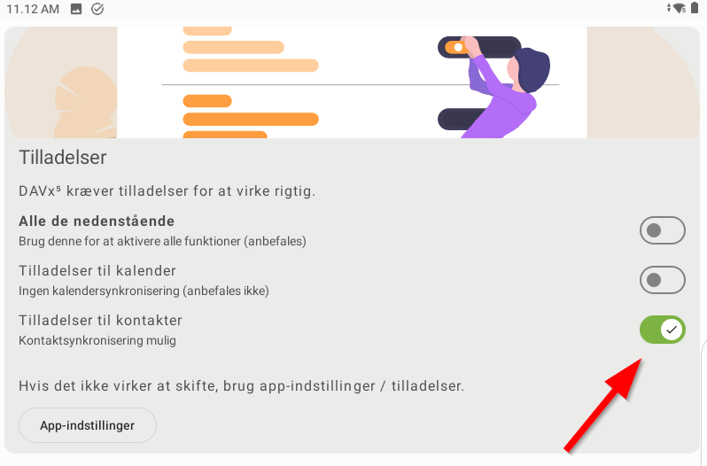
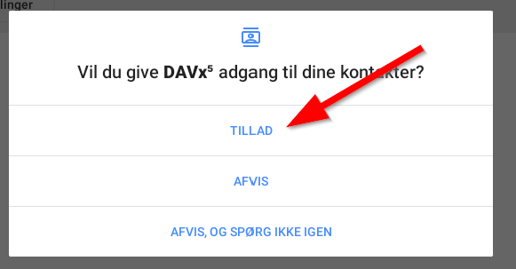

# **Hent kontakter til Android telefon**

## **Formål**

Når en kunde ringer, så bliver det nemmere at se hvem kunden er, da turnummeret vil komme op på telefonen.

## Indhold
- [**Hent kontakter til Android telefon**](#hent-kontakter-til-android-telefon)
  - [**Formål**](#formål)
  - [Indhold](#indhold)
  - [**Forudsætning**](#forudsætning)
  - [**Trin for trin vejledning**](#trin-for-trin-vejledning)
    - [**På fejerpro.dk**](#på-fejerprodk)
    - [**På telefonen**](#på-telefonen)

## **Forudsætning**

Det kræver rollen **Firmaadmin**, **Mester** eller **Kontor** at kunne ændre brugerens profil i FejerPro og dermed tildele en adgangskode til kontakter på mobil.

For at kunne hente kontakter fra FejerPro til en Android telefon er det nødvendigt at installere programmet DAVX5.

DAVX5 kan installeres fra Google Play Butik. I skrivende stund koster det 45 kr.

## **Trin for trin vejledning**

### **På fejerpro.dk**

> Forudsætning: Du skal have rollen Mester eller tilsvarende rettigheder.

1. Gå til **Administration → Brugeradministration** (1)
   ![Topmenu - Administration->Bruger administration][Topmenu - Administration->Bruger administration]

2. I brugeradministrationen trykkes på **+** (2) til højre for brugeren.
   ![Udvid info om bruger][Udvid info om bruger]

3. Under **Kunder på Mobil** (3) vælges telefontype (4) og der angives en adgangskode (5).
   ![Indsæt telefontype og adgangskode][Indsæt telefontype og adgang kode]

4. Tryk på **GEM** nederst på siden.

---

### **På telefonen**

1. Har du allerede installeret DAVX5, så gå til trin 6.
2. Gå i Google Play Butik.
   ![Gå i Google playbutik][Gå i Google playbutik]
3. Søg på DAVX5:
   1. Find søg i bunden af skærmen.
      ![Søg DAVX5][Søg DAVX5]
   2. Brug søgefeltet øverst på skærmen.
      ![Søgefelt i Google playbutik][Søgefel i Google playbutik]
   3. Skriv "davx5" og tryk enter eller vælg på listen.
      ![Indtast davx5][Indtast davx5]
4. Køb DAVX5 (45,00 kr).
   ![Køb Davx5][Køb Davx5]
5. Installér DAVX5.
6. Åbn DAVX5-appen.
7. Følg anvisningerne i appen:
   ![DAVX5 Startskærm][DAVX5 Startskærm]

   1. Markér **"Jeg behøver ikke opgave understøttelse"**.
      ![Behøver ikke opgavesupport][Behøver ikke opgavesupport]

   2. Aktivér **"Tilladelse til kontakter"**.
      
      

   3. Vælg om appen må synkronisere kontakter i baggrunden.
      ![Kør i baggrunden][Kør i baggrunden]

      - **(1)** Tillader at appen kører synkronisering i baggrunden, men det koster batteritid.
      - **(2)** Vælg denne, hvis du ikke ønsker regelmæssig synkronisering i baggrunden.

   4. Tillades synkronisering i baggrunden, kommer dette op — vælg **"Tillad"**.
      

   5. Ved næste skærm fortsættes uden at foretage ændringer.

8. Når du kommer til skærmen **"Velkommen til DAVX5"**, tryk på **Tilføj konto** nederst til højre.
   ![Opret Davx5 konto][Opret Davx5 konto]

9. Vælg **"Log ind med URL og brugernavn"**.
   ![Log ind med URL og brugernavn][Login ind med URL og brugernavn]

10. Tryk på **"Fortsæt"** nederst på skærmen.

11. Udfyld forbindelsesoplysningerne:
    ![Indtast server, brugernavn og adgangskode][server-user-password]
    - **(1) URL:** `www.fejerpro.dk`
    - **(2) Brugernavn:** Dit brugernavn til fejerpro.dk (med små bogstaver)
    - **(3) Adgangskode:** Den adgangskode der blev oprettet i FejerPro brugeradministration (punkt 4 ovenfor)

    Tryk på **"Log ind"**.

12. Vælg hvordan kontakter skal grupperes.
    ![Vælg hvordan kontakter skal grupperes][Vælg-hvordan-kontakter-grupperes]

13. Afslut oprettelse af konto.
    ![Afslut oprettelse][Afslut oprettelse]

14. Vælg **CardDAV** øverst (1).
    ![Vælg adressebog][select-addressbook]

15. Aktivér synkronisering med adressebogen (2).

16. Tryk på **Synkronisér** (3) — adressebogen vil nu blive synkroniseret.
    Bemærk: Det er muligt at synkroniseringen først sker i løbet af natten, så den kun kan ses næste dag.

[Topmenu - Administration->Bruger administration]: ../images/topmenu-useradmin.png
[Udvid info om bruger]: ../images/extend-userinfo-useradmin.png
[Indsæt telefontype og adgang kode]: ../images/setting-useradmin.png
[Gå i Google playbutik]: images/find-playbutik.png
[Søg DAVX5]: images/search-in-playbutik.png
[Søgefel i Google playbutik]: images/Playbutik-search-field.png
[Indtast davx5]: images/write-davx5.png
[Køb Davx5]: images/buy-davx5.png
[DAVX5 Startskærm]: images/DAVX5-startscreen.png
[Behøver ikke opgavesupport]: images/mark-no-need-casesupport.png
[Kør i baggrunden]: images/run-in-background.png
[Opret Davx5 konto]: images/create-davx5-account.png
[Login ind med URL og brugernavn]: images/login-with-url.png
[server-user-password]: images/enter-server-user-password.png
[login]: images/Logind.png
[Vælg-hvordan-kontakter-grupperes]: images/Select-group.png
[Afslut oprettelse]: images/finish-create-account.png
[select-addressbook]: images/select-addressbook-to-sync.png
