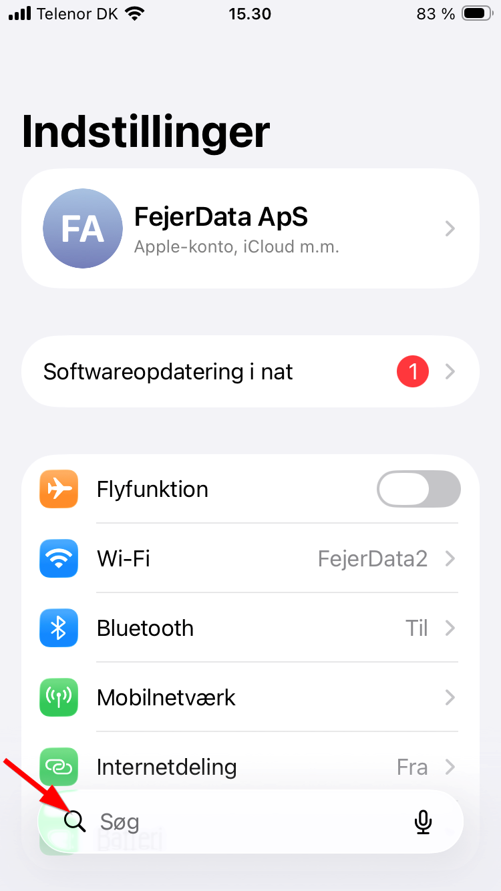
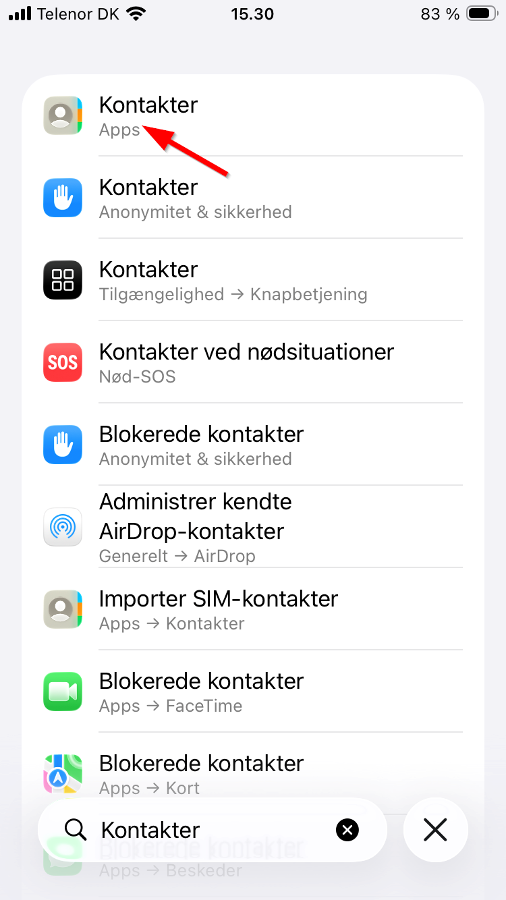
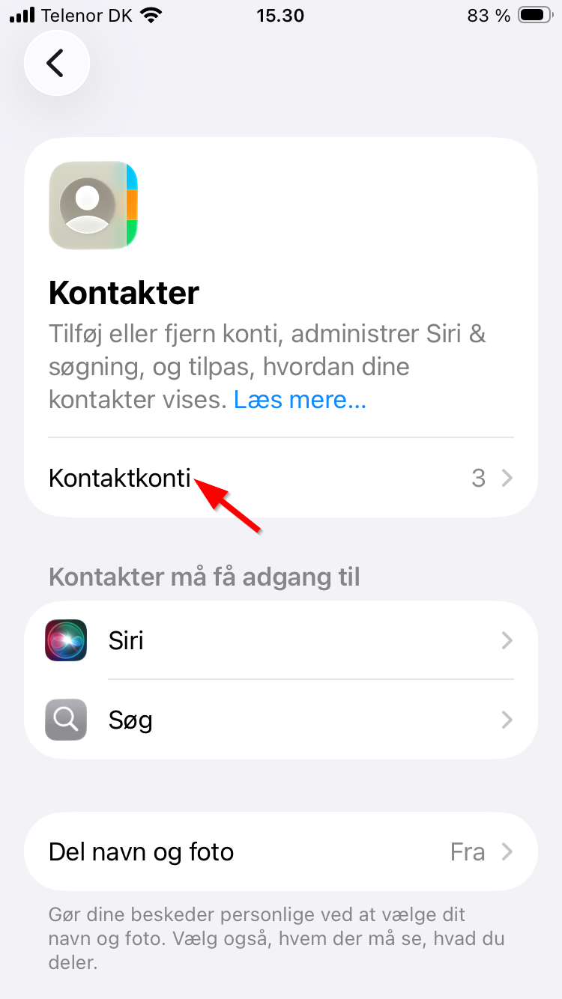
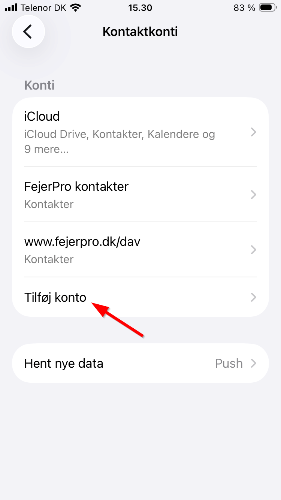
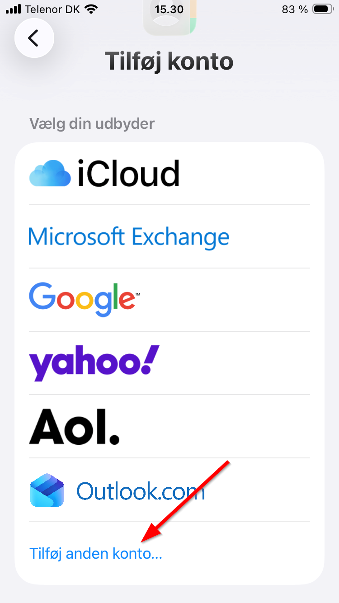
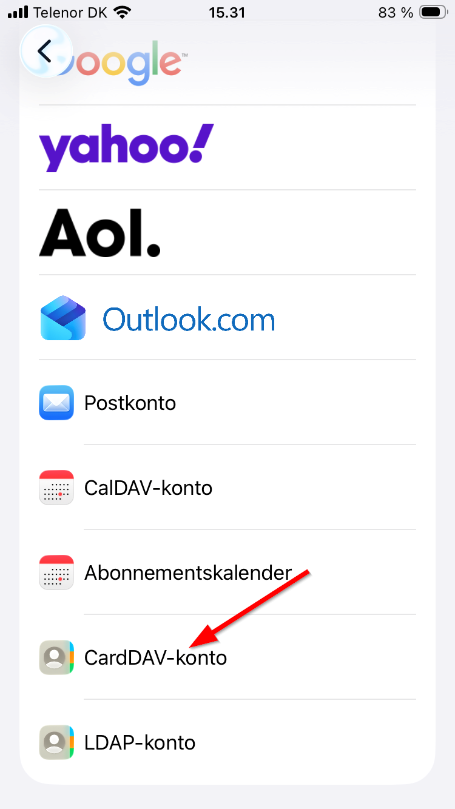
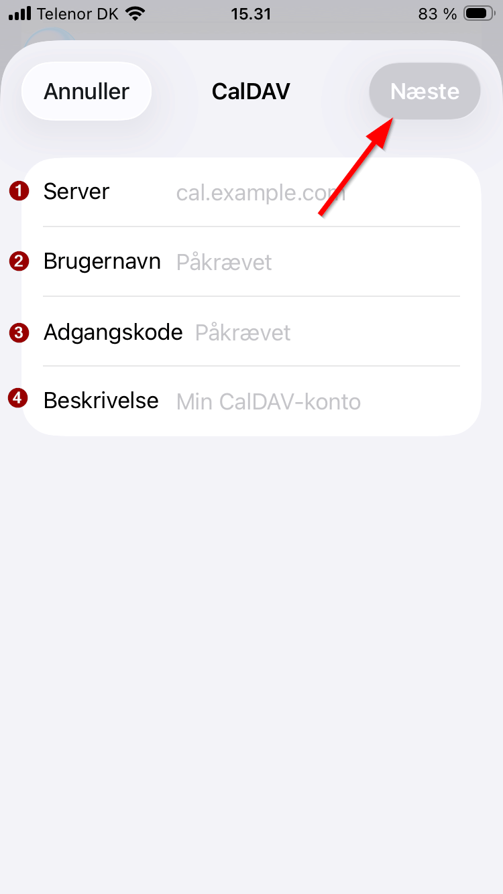

# Hent kontakter til iPhone

* [Hent kontakter til iPhone](#hent-kontakter-til-iphone)
  * [**Formål**](#formål)
  * [**Forudsætning**](#forudsætning)
  * [**Trin for trin vejledning**](#trin-for-trin-vejledning)
    * [**På fejerpro.dk**](#på-fejerprodk)
    * [**På iPhone**](#på-iphone)

## **Formål**

Når en kunde ringer, så bliver det nemmere at se hvem kunden er, da turnummeret vil komme op på telefonen.

## **Forudsætning**

Det kræver rollen Firmaadmin, Mester eller Kontor at kunne ændre brugerens profil i FejerPro og dermed tildele en adgangskode til kontakter på mobil.

iPhone har indbygget understøttelse af CardDAV — der skal ikke installeres nogen app.

## **Trin for trin vejledning**

### **På fejerpro.dk**

> Forudsætning: Du skal have rollen Mester eller tilsvarende rettigheder.

1. Gå til **Administration → Brugeradministration** (1)
   ![Topmenu - Administration->Bruger administration][topmenu-useradmin]

2. I brugeradministrationen trykkes på **+** (2) til højre for brugeren.
   ![Udvid info om bruger][extend-userinfo]

3. Under **Kunder på Mobil** (3) vælges telefontype (4) og der angives en adgangskode (5).
   ![Indsæt telefontype og adgangskode][setting-useradmin]

4. Tryk på **GEM** nederst på siden.

---

### **På iPhone**

1. Åbn **Indstillinger** og søg efter "Kontakter" i søgefeltet øverst.
   

2. Tryk på **Kontakter** (Apps) i søgeresultatet.
   

3. Tryk på **Kontaktkonti**.
   

4. Tryk på **Tilføj konto**.
   

5. Rul ned og tryk på **Tilføj anden konto...** nederst.
   

6. Tryk på **CardDAV-konto**.
   

7. Udfyld forbindelsesoplysningerne og tryk på **Næste**:
   
   - (1) **Server:**  `www.fejerpro.dk/dav`
   - (2) **Brugernavn:** Dit brugernavn til fejerpro.dk (med små bogstaver)
   - (3) **Adgangskode:** Den adgangskode der blev oprettet i FejerPro brugeradministration (punkt 4 ovenfor)
   - (4) **Beskrivelse:** F.eks. `FejerPro kontakter`

8. Kontakterne vil nu blive synkroniseret til telefonen.
   Bemærk: Det er muligt at synkroniseringen først sker i løbet af natten, så den kun kan ses næste dag.

[topmenu-useradmin]: ../images/topmenu-useradmin.png
[extend-userinfo]: ../images/extend-userinfo-useradmin.png
[setting-useradmin]: ../images/setting-useradmin.png
