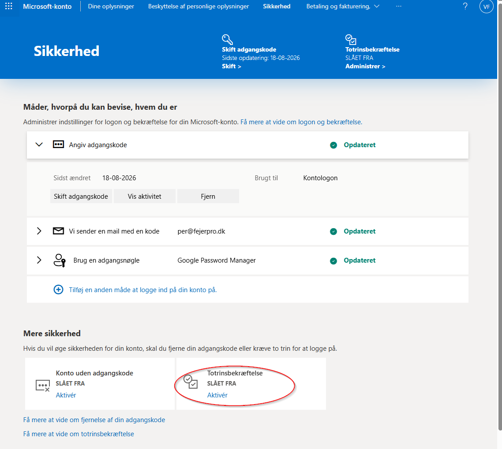
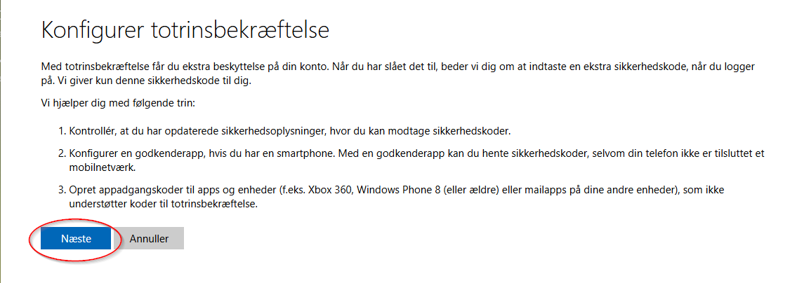
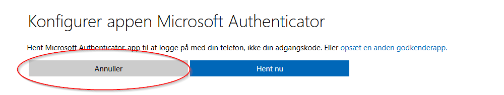
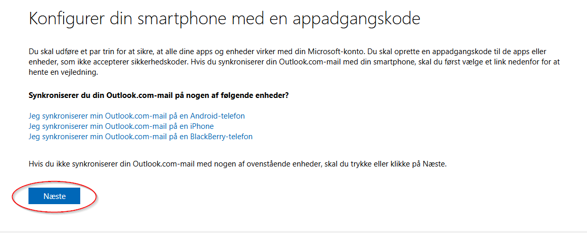
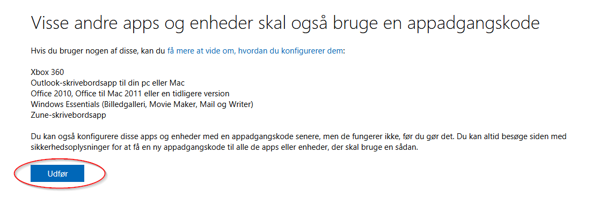
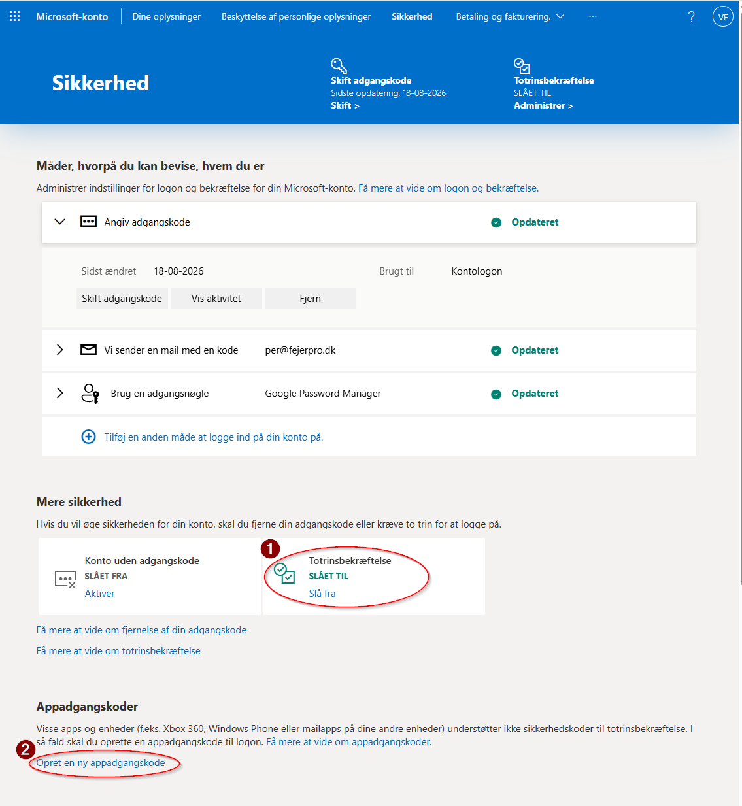
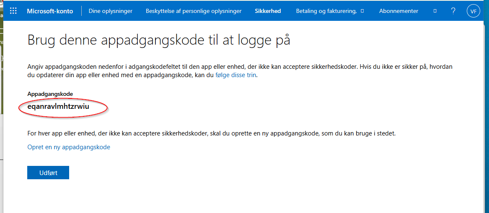

# Aktivering brugen af SMTP på outlook

## Beskrivelse

For at det er muligt at sende mail via SMTP til en outlook konto, så skal der bruges et apppassword.

## Fremgangsmåde

1. Gå ind på adressen https://go.microsoft.com/fwlink/?linkid=2274139
2. log på med dine Bruger og adgangskode

    Får du et billede som dette, så er ToTrinsBekræftelse ikke slået til ?

    

    Følg vejledningen pkt. 3. til 8. for at slå den til.

    Er ToTrinsBekræftelse slået til, så kommer du direkte til pkt. 9.

3. Slå ToTrinsBekræftelse til

    Klik på "Aktiver"

4. Du bliver bedt om konfigurer totrinsbeskræftelsen

    Tryk på næste

    
5. Konfigurerer appen Microsoft Authenticator

    Her kan du vælge at hente og bruge Microsoft Authenticator.
    Ønsker du dette trykker du på Hent nu.

    Her vælger Jeg  at annuller

    

6. Så får du muligheden for at konfigurer f.eks. din smartphone med appadgangskode.

    Ønsker du dette, stå trykker du med vejledning for din telefon, og følger vejledningen.

    Her vælger jeg Næste

    

7. Så kommer den med side med oplysninger om forslag til at bruge appadgangskode

    Her trykkes på Udfør

8. Så kommer du ind på dette billede hvor du kan se at ToTrinsBekræftelse af slået til (1)

    Og længere ned får du muligheden for at oprette en AppAdgangskode (2)

    

    Tryk på "Opret en ny appadgangskode" (2)

9. Så får du en Appadgangskode

    

    Det er den kode der skal bruges for at oprette adgang til at sende mails via SMTP via din konto.

    Kopier koden og send den til support med en gul seddel ( se i toppen af fejerpro)

PS. den i billedet angivet Appadgangskode kan ikke bruges