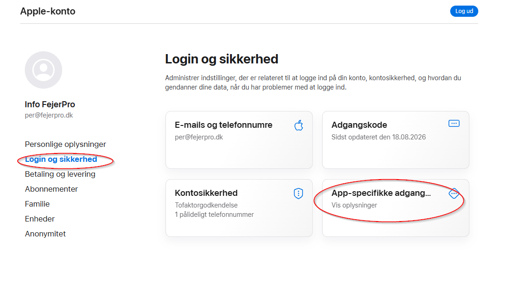
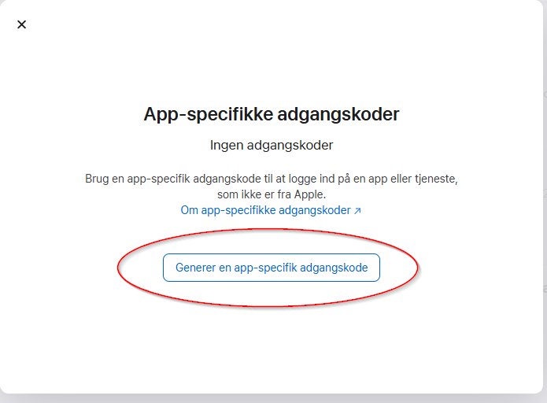
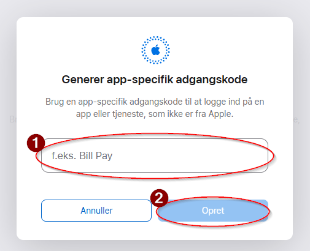
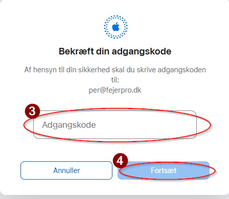
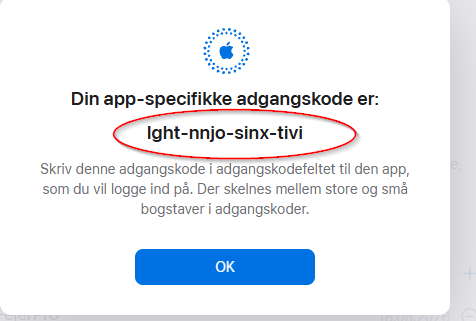

# Hvordan får jeg en appadgangskode til iCloud mail

## Beskrivelse

For at kunne opsætte en adgang til at sende e-mail på dine vegne, så har vi brug for en appadgangskode til din iCloud konto

## Fremgangsmåde

1. Gå til appleid.apple.com
2. Log ind med din Apple ID
3. Gå til "Sikkerhed"

    

4. Vælg "App-specifikke adgangskoder"

    

5. Giv den et navn (1) f.eks. FejerPro og tryk på Opret (2)

    

6. Angiv din adgangskode (3) til din iCloud konto og tryk forsæt (4)

    

7. Din App-specifikke adgangskode

    Kopier koden og send via gul seddel til support med oplysning om hvilken bruger den gælder for

    

Bemærk: Den viste kode er ikke længere gyldig
