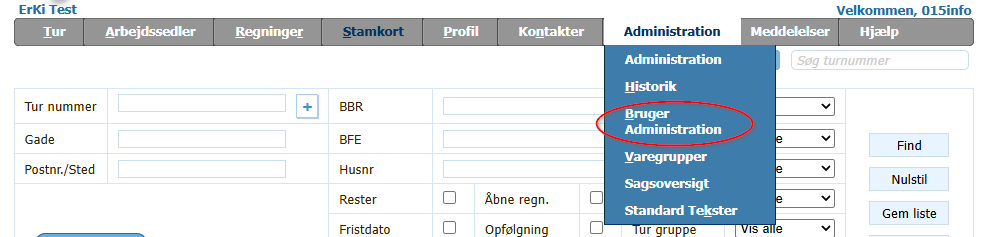
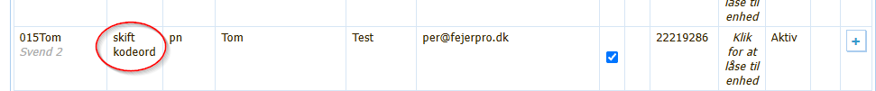
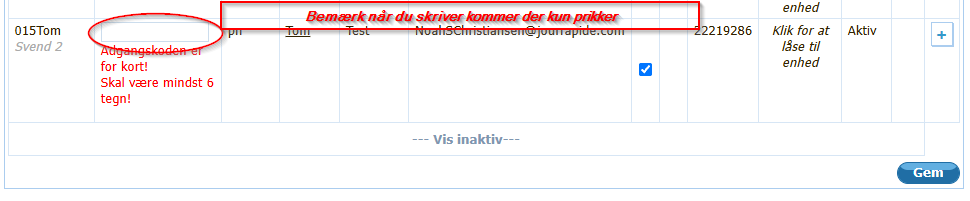
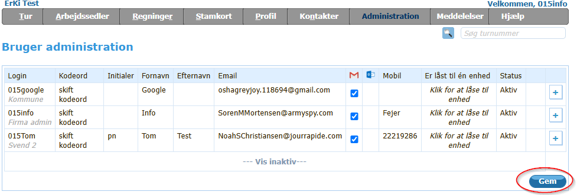

# Tildel_eller_skift_adgangskode til bruger

## Forudsætning

Du har en af rollerne
- Firma admin
- Mester
- Kontor

Har du ikke en af disse roller, så kontakt din mester eller support

- Adgangkoden skal være på mindst 6 tegn max 34 karakter
- tegn skal være bogstaver, tal eller tegn.
- Følgende tegn er tilladt
  - /*-+-.,;:!"#¤%&/()=§½\><>?

## Vejledning

1. Gå "Administration" -> "Bruger administration"

    

2. Klik på "skift kodeord"

    

3. Angiv den adgangskode der ønskes som kodeord ( mindst 6 tegn -  max 34 tegn)

    

4. Tryk på "Gem" nederst til højre

    