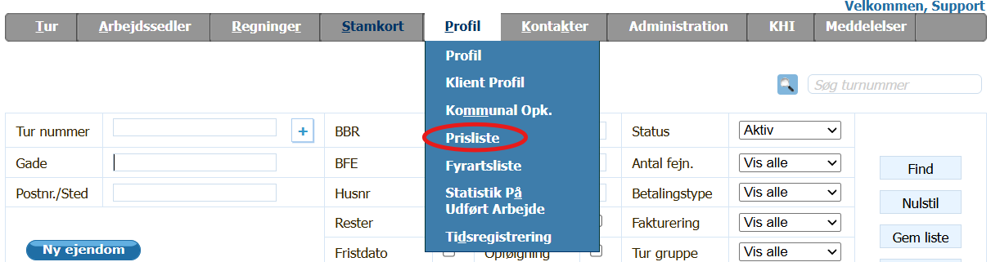
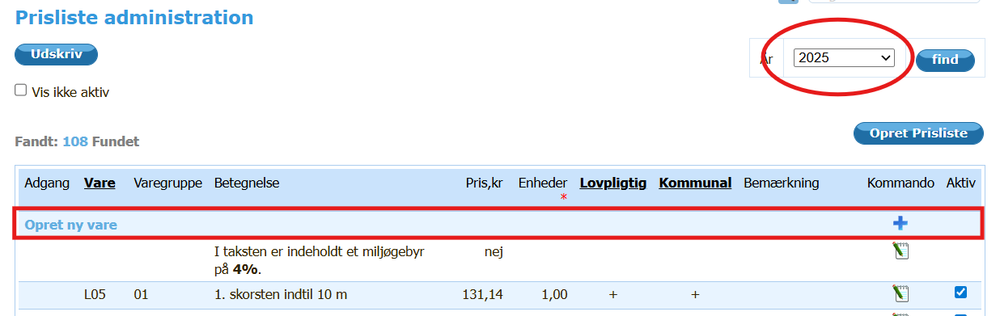
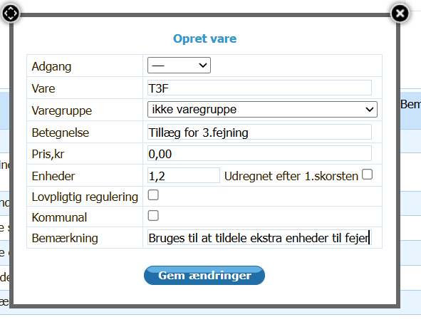
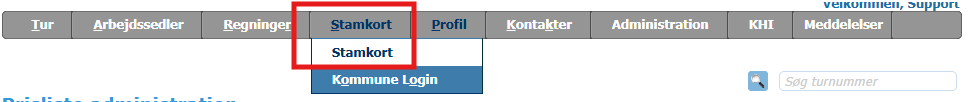
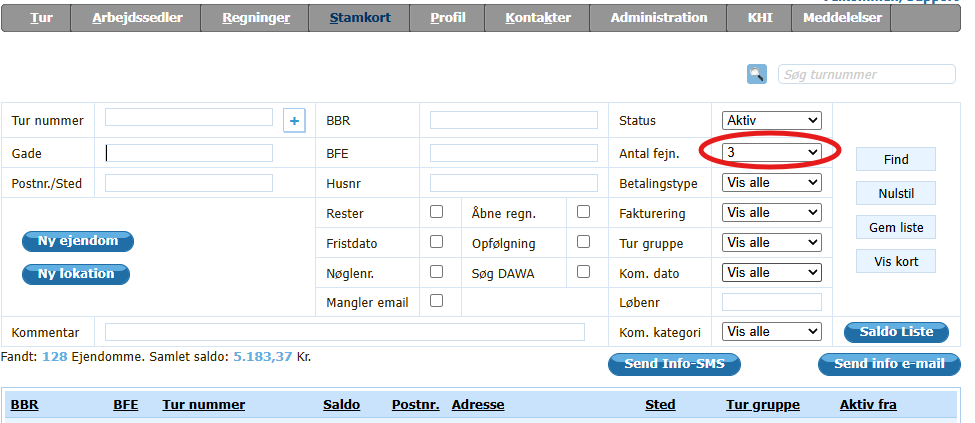
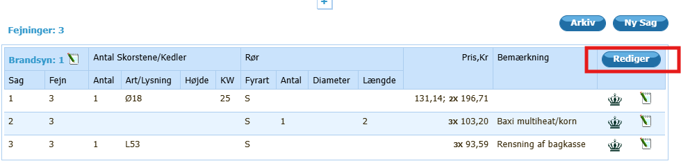
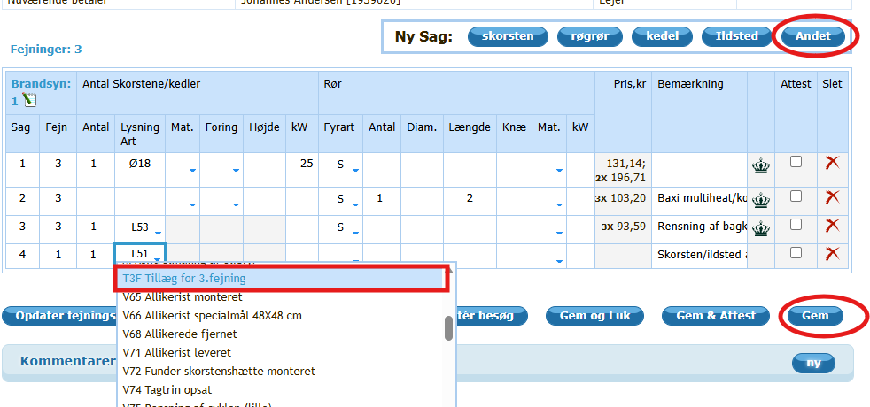
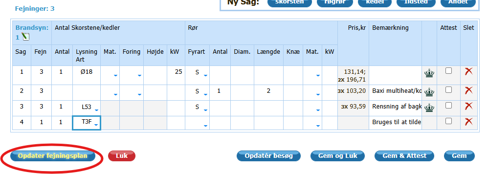
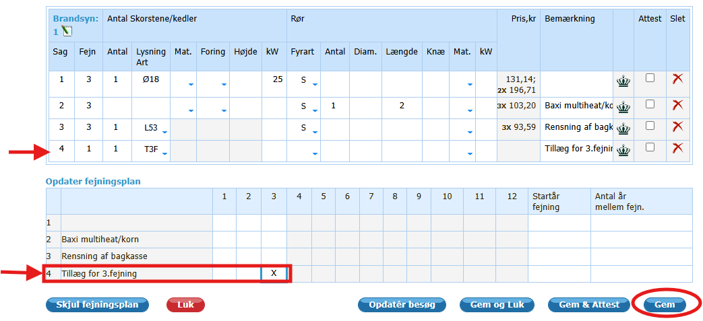

# Hvordan tildeles enheder til bestemte fejninger

## Beskrivelse

Hvis du ved en bestemt fejning ønsker at tildele fejeren bestemt antal enheder.

- Det gøres ved at oprette en vare der ikke koster noget
- Angive antal enheder fejeren skal have for udførelsen.
- Tilføje varen til de ejendomme hvor fejeren skal have tillægget.
- Hvis tillæget skal udføres på en bestemt fejning, så angives som en 1x sag.
- Der oprettes en individuel fejning plan for på hvilken fejning denne sag udføres

I den nedenstående vejledning tages der udgangspunkt i at der ønskes tildeles 1,2 ekstra enheder for den 3. fejning af en ejendom.

## trin for trin.

1. Opret i prislisten en ekstra vare.
    I dette tilfælde giver den varekode T3F.
    1. gå ind på prislisten
    

    2. Sikre dig at årstallet for prislisten er det år du er i
     Her 2025
     
    
    3. tryk på + udfor opret vare 
    

    - Adgang - angiver hvem der får tillægget   
      Her er ikke angivet nogen, da alle får det.
    - Vare - Varens kode  
        Her er brugt T3F som forkortelse for tillæg 3. Fejning
    - Varegruppe - Angivelse af hvilken type vare det er  
        Her er brugt "ikke varegruppe" da varen ikke passer til nogle af de eksisterende varegrupper
    - Betegnelse - Her angivet en mere klar tekst for varen  
        Her er brugt tillæg for 3. fejning
    - pris - her angives 0,00 , da kunden ikke skal betale for denne vare  
    - Enheder - Angivelse af enheder der tildeles fejeren, normalt bliver dette udregnet efter 1. skorsten.  
        fjern markering i "Udregnet efter 1. skorsten og angiv det antal enheder som fejeren skal have for udførslen.  I dette tilfælde bruges 1,2
    - Lovpligtig regulering - efterlades tom, da det ikke lovpligtig
    - Kommunal - Efterlades tom, da det ikke skal opkræves kommunalt
    - Bemærkning - Her kan skrives en ekstra bemærkning omkring varen  
        Her har jeg beskrevet hvad varen bruges til
    - Tryk på "gem ændringer"
2. Find de ejendomme der skal have denne vare tilføjes.  
    Hvis det drejer sig om flere ejendomme kan det gøres på følgende måde
    - Vælg stamkort i topmenuen  
    
    - I filteret angive hvilke ejendomme der skal udvælges.  
        Her har jeg valgt ejendomme med 3 fejninger, da det er de ejendomme som varen skal tillægges
        
    - Vælg en ejendom
    - Opret en ny sag med den nye vare ved at trykke på rediger  
        
    - Vælg andet  
        
        - Lysnings art vælges din vare.  
            Her T3F
        - Fejn - bliver stående på 1
        - Sag - i dette tilfælde sag 4.
        - tryk på gem
    - Opret en individuel fejningsplan  
        
        - Vælg på hvilken på hvilke besøg/Fejning som sagen skal udføres for denne ejendom.
            
            Når der her angives på hvilke besøg/Fejning en given sag skal udføres, så overskriver det hvad der står i fejningsplanen for turen
        - Her har vi valgt at den skal foretages på 3. besøg/fejning
        - Tryk på "gem" for at gemme.

Nu er der oprettet en sag på denne ejendom, hvor fejeren får et tillæg når han udfører 3. fejning på ejendommen.

Dette gentages så for alle de ejendomme, hvor tillægges gives.

    
