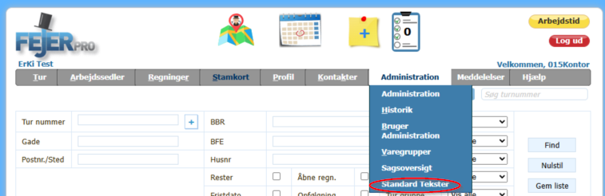
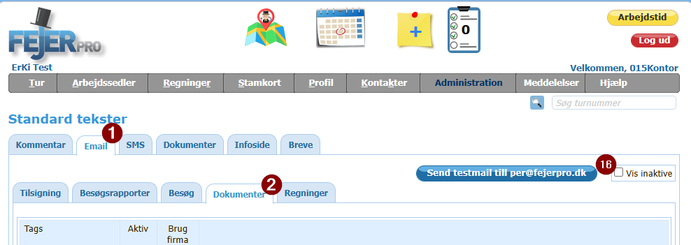
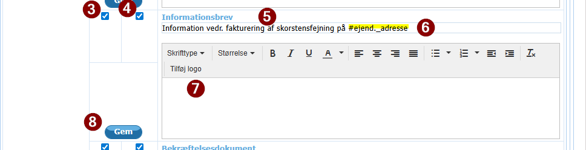
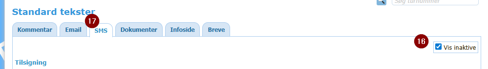
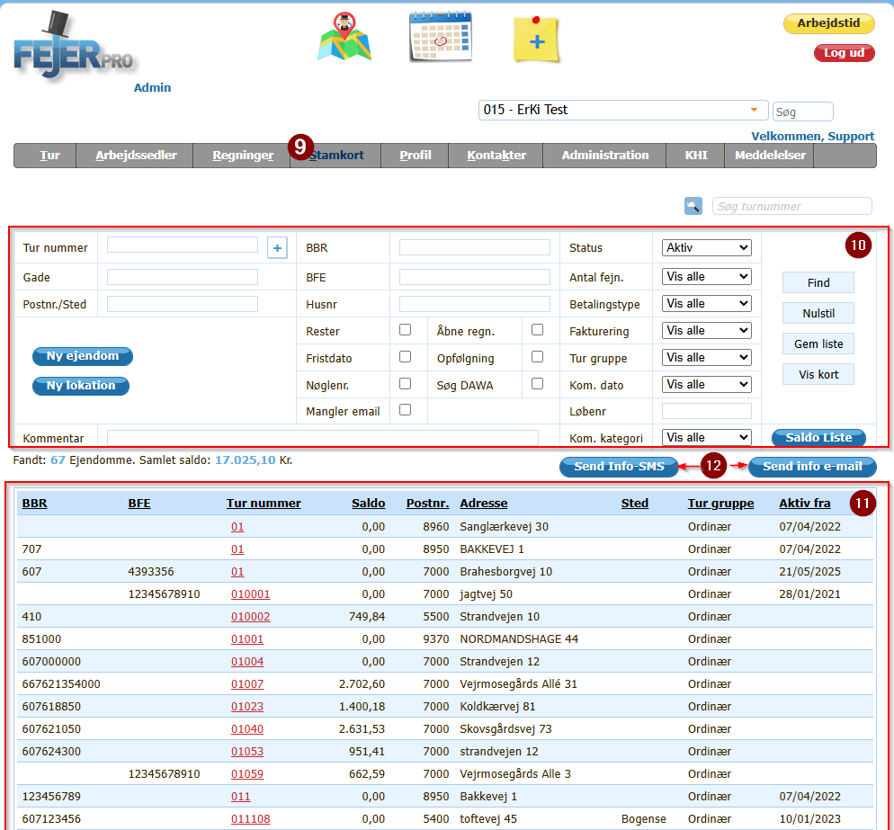
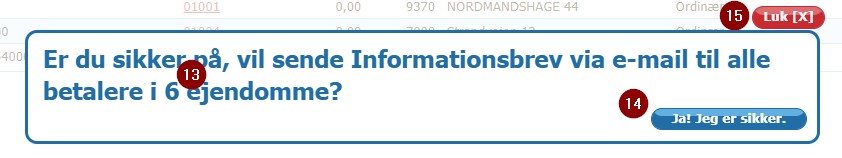

## Vejledning til udsendelse af general information til kunderne

Det kan ind i mellem være nødvendigt at udsende en generel information til en gruppe af kunder.

### Hvem kan udsende disse generale informationer til kunderne.

Brugere med rollen **Mester, FirmaAdmin, Kontor** kan udsende general information til kunderne

### Hvordan

Informationen kan udsende både på E-mail og SMS.

Dette gøres ad to omgange, en for e-mail og en for sms

#### Vejledning for udsendelse for E-mail

1. Først skal informationen formuleres.
   1. Det gøres under topmenu'en Administration -> Standard Tekster  
    
   2. Her vælges fanen Email (1)  
      
   3. Derefter vælges fanen Dokumenter (2)  
   4. Find Standard Tekst for Informationsbrev(5)  
     Hvis Du ikke kan se standard tekst for Informationsbrev, så er den inaktiv.
     Sæt markering i "Vis inaktive" øverst oppe til højre (16)
      
      1. Sørg for at den er markeret aktiv (3) og evt aktiv for firmas signatur (4)
      2. Udfyld overskriften/ titlen  for information (6)
          Teksten #ejend._adresse vil blive erstatet med ejendommens adresse når beskeden sendes og anbefales at indgå i overskriften
      3. Skriv indholdet af informationen (7)
      4. Tryk på gem til venstre for informationsbrevs tekst boks. (8)

#### Vejledning for udsendelse for SMS

1. Først skal informationen formuleres.
   1. Det gøres under topmenu'en Administration -> Standard Tekster  
    
   2. Her vælges fanen SMS (17)  **Husk at sætte markering i "Vis inaktive" (16)**
       
   3. Derefter bladres der ned i bunden til sektionen "Administration" (18) 
   4. Find Standard Tekst for Informationssms  (19)
     Hvis Du ikke kan se standard tekst for Informationssms, så er den inaktiv.
     Sæt markering i "Vis inaktive" øverst oppe til højre (16)
      
      1. Sørg for at den er markeret aktiv (20)    
      2. Skriv indholdet af informationen (19)
          Teksten #adresse vil blive erstatet med ejendommens adresse når beskeden sendes og anbefales at indgå i teksten
      3. Tryk på gem nederst til højre i sektionen (21)  

#### Vejledning til at finde de ejendomme der skal sendes til

  
1. Vælg stamkort på topmenu'en (9)
2. Via filter indstillingerne (10) findes de ejendomme der skal have beskeden f.eks. ejendomme på en bestemt lokation ( De første 2 tal i turnummer)
3. Tjek at listen (11) kun indeholder de ejendomme der skal have informationsbrevet eller informationssms og de alle er med.  
     Hvis det ikke er tilfælde
     1. For mange ejendomme, så ændre filter indstillingerne til færre ejendomme
     2. Mangler ejendomme
        1. Ret filteret til at omfatte alle ejendomme
        2. eller send til de ejendomme på listen, og lav et nyt filter der udsøger resten af ejendommene
4.  Tryk på kanppen "send infor e-email" eller "Send infor SMS" (12)  
     **Knappen findes kun når standard teksten "Informationsbrev"  eller Informationssms er aktiv**
5. Der kommer herefter er popup vindue op med dette udseende  
     **Bemærk mailen bliver sendt til betalere på ejendommene**  
     
     Her står hvor mange der sendes(13)  
6. Ønsker du at gennemfører udsendelsen, så tryk på "Ja! Jeg er sikker" (14) ellers på "Luk" (15)           