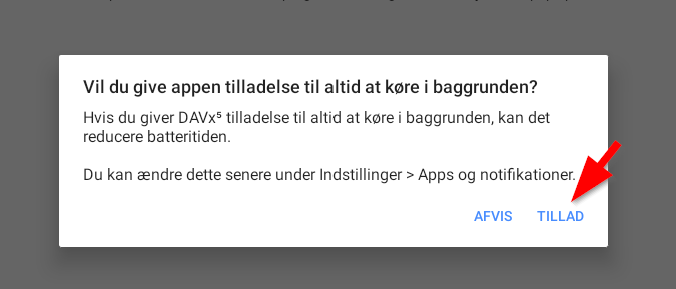

# Hent kontakter til android telefon

- [Hent kontakter til android telefon](#hent-kontakter-til-android-telefon)
  - [Formål](#formål)
  - [Forudsætning](#forudsætning)
  - [Trin for trin vejledning](#trin-for-trin-vejledning)

## Formål

Når en kunde ringer, så bliver det nemmere at se hvem kunden er, da den vil komme op med turnummer på telefonen

## Forudsætning

Det kræver rolle som Fimaadmin, Mester eller Kontor, at kunne ændre på brugerens profil i FejerPro, og dermed tildele en adgangkode til kontakter på mobil.

For at kunne hente kontakter fra FejerPro til Android telefon, er det nødvendigt at installlere programmet DAVX5

DAVX5 kan installeres fra Google playbutik

I skrivende stund koster det 45 kr.

## Trin for trin vejledning

**På fejerpro.dk**
**Forudsætning for de næste skridt er at du har en rolle som Mester eller med lignende rettigheder**

1. Gå i administration -> Bruger administration (1)
    ![Topmenu - Administration->Bruger administration][Topmenu - Administration->Bruger administration]

2. I bruger administrationen trykkes på **+** (2) til højre for brugeren.
    ![Udvid info om bruger][Udvid info om bruger]

3. "Kunder på Mobil" (3) her vælges tlf type (4) og gives en adgangskode (5)
    ![Indsæt telefontype og adgang kode][Indsæt telefontype og adgang kode]

4. Tryk på GEM forneden på siden

**På telefonen**

1. Hvis du allerede har installeret DAVX5 så gå til trin 6
2. Gå i Google Play butik
    ![Gå i Google playbutik][Gå i Google playbutik]
3. Søg på DAVX5
   1. Find søg i bunden af skærmen
    ![Søg DAVX5][Søg DAVX5]
   2. Derefter søgefelt i toppen af skærmen
    ![Søgefelt i Google playbutik][Søgefel i Google playbutik]
   3. Skriv "davx5" og tryk enter eller vælg på listen
    ![Indtast davx5][Indtast davx5]

4. Køb DAVX5
    Davx5 koster 45,00 kr
    ![Køb Davx5][Køb Davx5]
5. Installerer DAVX5
6. Åben DAVX5 app'en
7. Følg anvisningerne i App'en

    ![DAVX5 Startskærm][DAVX5 Startskærm]

   1. Marker i "Jeg behøver ikke opgave understøttelse"

    ![Behøver ikke opgavesupport][Behøver ikke opgavesupport]

   2. Aktiver "tilladelse til kontakter"

    

    

   3. Vælg om den skal have lov til at lave synkronisering af kontaktr i baggrund

    ![Kør i baggrunden][Kør i baggrunden]

    (1) tillader at app-en køre synkronisering i bagrund, men det koster batteritid

    (2) Sæt denne, hvis du ikke mener det er nødvendigt med regelmæssig synkronisering i baggrunden

   4. Tillades synkronisering i baggrunden kommer dette op
    

        Vælg "Tillad"

   5.  Ved næste skærm forsættes uden noget.

8. Når du kommer til skærmen "Velkommen til DAVX5"
    ![Opret Davx5 konto][Opret Davx5 konto]

    Tryk på Tilføj konto nederst til højre

9.  vælg "log ind med URL og brugernavn"
    ![Login ind med URL og brugernavn][Login ind med URL og brugernavn]

10. Tryk på "Forsæt" nederst på skærmen

11. i URL indtastes "www.fejerpro.dk" (1)
    ![Indtast server, brugernavn og adgangskode][server-user-password]

12. i brugernavn indtastes dit brugernavn til fejerpro.dk med små bogstaver (2)

13. i adgangskode skrives den adgangskode der blev lavet i fejerpro.dk brugeradministration (punkt 4) (3)

14. tryk på "Log ind"
    ![Log ind][login]

15. Gruppering af kontakter
    ![Vælg hvordan kontakter skal grupperes][Vælg-hvordan-kontakter-grupperes]

16. Afslut oprettelse af konto
    ![Afslut oprettelse][Afslut oprettelse]

17. Vælgt Carddav i toppen (1)
        ![Vælg adressebog][select-addressbook]

18. Aktiver synkronisering med adressebog (2)

19. Tryk på synkorniseres (3) og adresse bogen vil bliver synkroniseret.
    Det er muligt, det først vil ske i løbet af natten, så det derfor først kan ses næste dag.

[Topmenu - Administration->Bruger administration]: ../images/topmenu-useradmin.png
[Udvid info om bruger]: ../images/extend-userinfo-useradmin.png
[Indsæt telefontype og adgang kode]: ../images/setting-useradmin.png
[Gå i Google playbutik]: images/find-playbutik.png
[Søg DAVX5]: images/search-in-playbutik.png
[Søgefel i Google playbutik]: images/Playbutik-search-field.png
[Indtast davx5]: images/write-davx5.png
[Køb Davx5]: images/buy-davx5.png
[DAVX5 Startskærm]: images/DAVX5-startscreen.png
[Behøver ikke opgavesupport]: images/mark-no-need-casesupport.png
[Kør i baggrunden]: images/run-in-background.png
[Opret Davx5 konto]: images/create-davx5-account.png
[Login ind med URL og brugernavn]: images/login-with-url.png
[server-user-password]: images/enter-server-user-password.png
[login]: images/Logind.png
[Vælg-hvordan-kontakter-grupperes]: images/Select-group.png
[Afslut oprettelse]: images/finish-create-account.png
[select-addressbook]: images/select-addressbook-to-sync.png